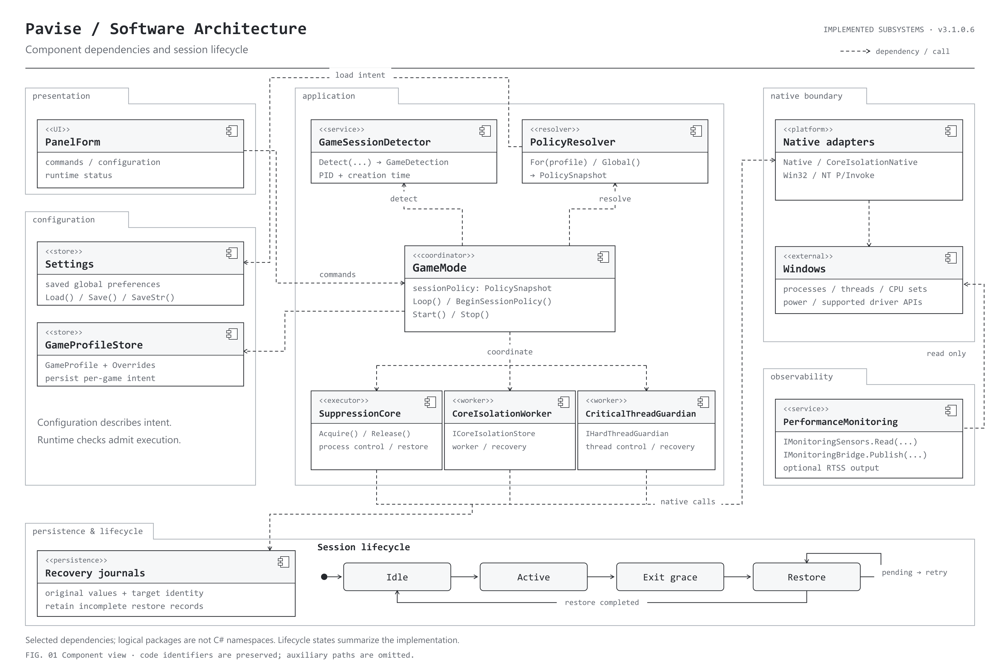
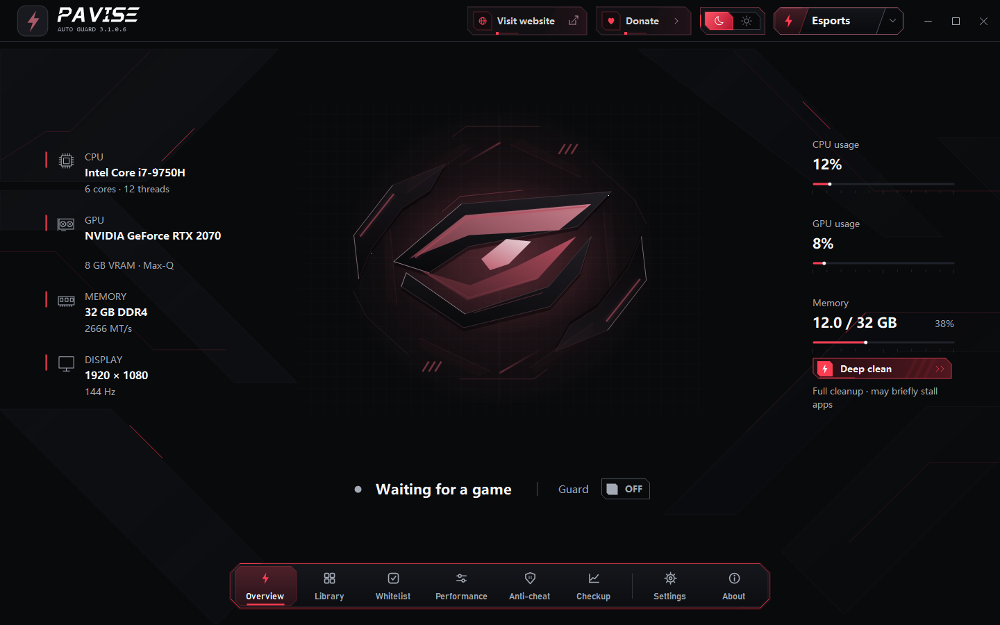
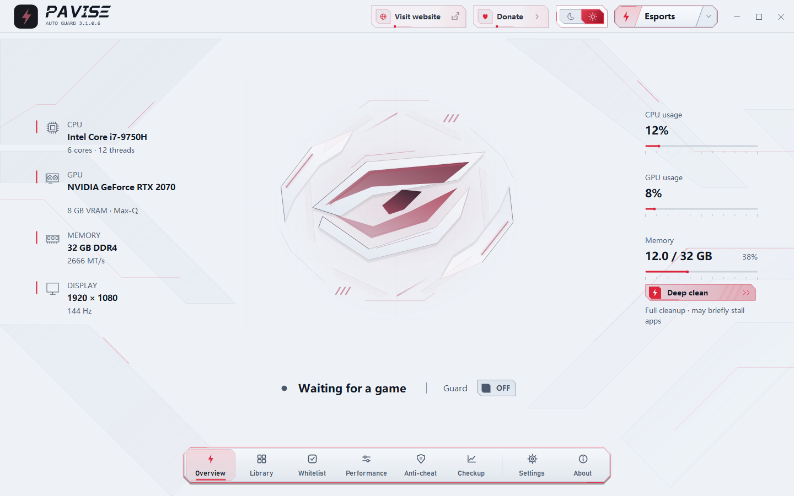

# PAVISE

### ゲームセッションを境界とする、リソース制御。

ゲームの識別、明示的なユーザー設定、復元記録を軸にした 
Windows リソース制御システム。

[English](README.en.md) · [简体中文](README.md) · **日本語**

**3.1.0.6 のソースコードは整理中です。数日以内に公開予定です。** 現在の過去のソースは、本リリースの最新実装を示すものではありません。

**[公式サイト](https://pavise.club/en/) · [ダウンロード](https://pavise.club/en/changelog/#latest) · [ユーザーガイド](https://pavise.club/en/docs/)**

## システム設計

*図 1 · コンポーネントの依存関係とセッションのライフサイクル。[ベクター原図](docs/pavise-architecture.svg)。*

Pavise はリソース制御を、境界のあるゲームセッションとして扱います。ゲームと関連プロセスを識別し、保存した選択から有効な方針を決定し、Windows のネイティブ API を通して制御します。セッション終了時には、記録した変更の復元を行います。

**強度より先に範囲を定める。** プロセスの同一性、前面状態、CPU 構成で対象を限定します。ゲームの実行とバックグラウンドの競合を別の経路で扱い、保護規則と実行環境の対応状況を確認します。

**設定と観測を分ける。** 保存した設定が要求を定め、現在の状態が実行可能性を決めます。測定値は観測と比較のために提示し、性能設定の選択はユーザーに委ねます。

**復元を制御の一部とする。** 対象となる変更には元の値と復元記録を保持します。終了時に照合し、未完了の復元は保留として残します。永続設定とキャッシュ操作には、それぞれのライフサイクルがあります。

## インターフェース

*3.1.0.6 UI。画像はデモデータを使用し、ベンチマーク結果ではありません。アプリの言語選択は中国語と英語のため、英語 UI を掲載しています。*

ライトテーマ

## 実行

Windows 10 2004 / ビルド 19041 以降、.NET Framework 4.7.2 以降。リソース制御には管理者権限が必要です。

配布パッケージ全体を展開し、`Pavise.exe`、`Pavise.exe.config`、`LICENSE`、`NOTICE` を同じフォルダーに置きます。ゲームを追加し、保存した方針を確認して Guard を有効にしてください。設定と復元は[ユーザーガイド](https://pavise.club/en/docs/)を参照してください。

効果はゲーム、ハードウェア、設定に依存します。同じ負荷で比較してください。制御項目を増やしても性能向上が保証されるわけではありません。

## プロジェクト

[Issues](https://github.com/dulaiduwang003/Pavise-Game/issues) · [Contributors](https://github.com/dulaiduwang003/Pavise-Game/graphs/contributors) · [作者 bdth](https://github.com/dulaiduwang003) · [開発を支援](https://pavise.club/support/)

現在のリリースには配布パッケージを使用してください。ソースは整理後に公開します。不具合にはバージョン、環境、再現手順を記載してください。

Pavise は無料で入手できます。寄付は任意です。QQ コミュニティ：`166255062` / `1109874913`。

作者を支援

 

**ライセンス：** [GPL-3.0-only](LICENSE)。Copyright (C) 2026 bdth。[NOTICE](NOTICE) を参照してください。
