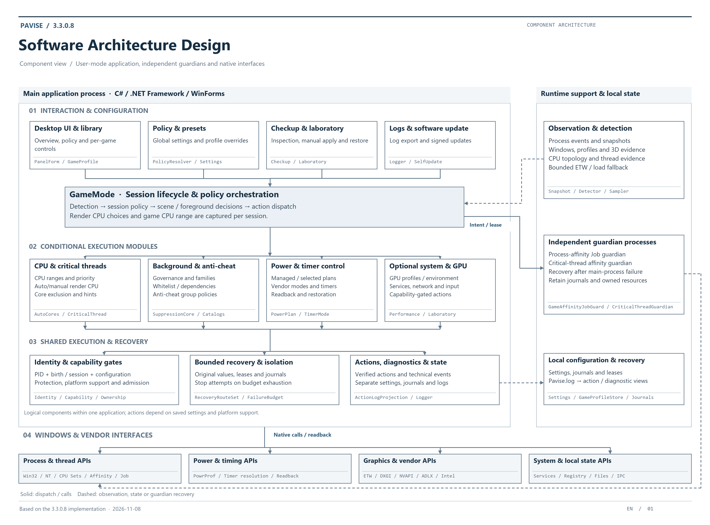
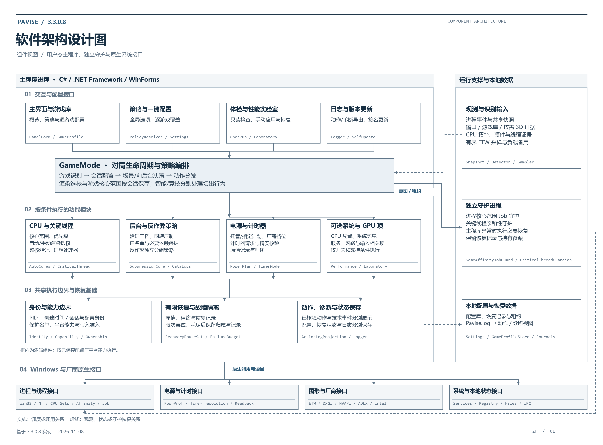
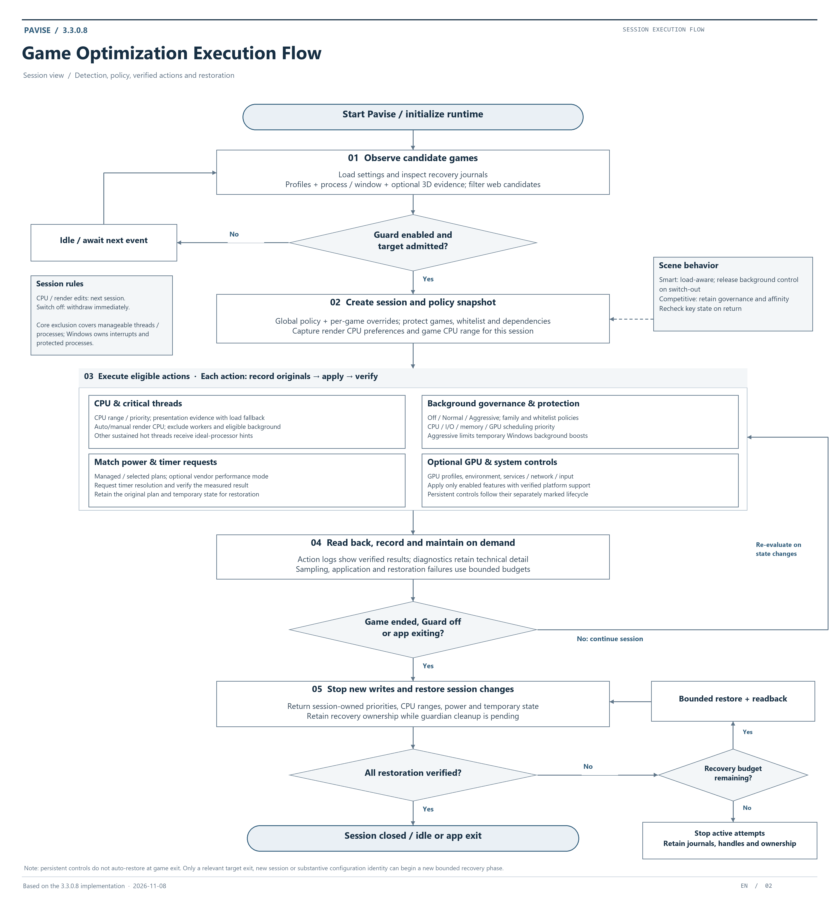
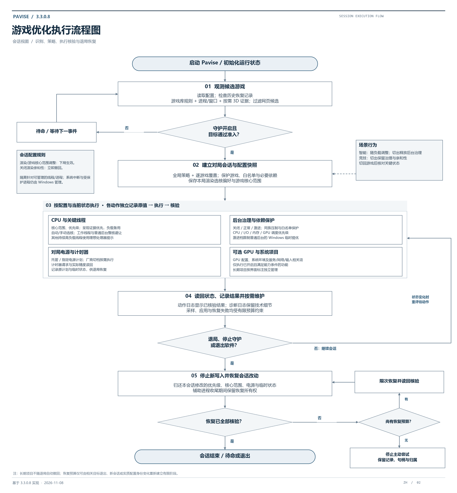

<div align="center">

<a href="https://pavise.club/en/">
  
</a>

# PAVISE

**English** · [简体中文](README.zh-CN.md) · [日本語](README.ja.md)

### Leave the resources to your game.

**A free, open-source runtime resource manager for Windows games.**<br>
Intelligent background suppression during play helps your existing hardware devote more of its performance to the current game.

**3.3.0.8 · Intelligent background suppression · Per-game configuration · Action and diagnostic logs**

[](LICENSE)
[](https://github.com/dulaiduwang003/Pavise-Game/releases/latest)
[](https://github.com/dulaiduwang003/Pavise-Game/releases)
[](https://github.com/dulaiduwang003/Pavise-Game/stargazers)

**[Website](https://pavise.club/en/) · [Download and updates](https://github.com/dulaiduwang003/Pavise-Game/releases/latest) · [User guide](https://pavise.club/en/docs/v3/) · [Report an issue](https://github.com/dulaiduwang003/Pavise-Game/issues)**

</div>

> This repository provides **Pavise source code, build instructions, and runnable regression tests**. Official downloads and release notes are on the [releases page](https://github.com/dulaiduwang003/Pavise-Game/releases/latest).

## Why runtime resource management?

Pavise is a free, open-source **runtime resource manager for Windows games**. Built around intelligent background suppression during play, it coordinates CPU placement, critical threads, performance priorities, and power policies for the current game.

**Pavise focuses on how resources are allocated and used while a game is running.** A clean Windows installation is only part of the picture: the game's thread placement, CPU selection, power state, and competition for resources also matter. Per-game configuration, execution checks, and restoration after play give players control over runtime scheduling and help them get more from the hardware they already own.

Our goal is to make **professional Windows gaming resource management freely available to every player, for a smoother and more consistent gaming experience.** Players should not need expensive optimization software to make good use of their own hardware. That is why Pavise remains free and open source: its implementation can be read, its behavior can be checked, and its tools are available to everyone.

## At its core: intelligent background suppression

**Pavise reduces competition from background activity during play, leaving more of your hardware's existing performance available to the game.** Browsers, launchers, updaters, and other background applications share CPU, disk, and GPU resources with your game. Pavise manages eligible background workloads according to the selected mode and current load.

Once the guard is enabled and a game is detected, Pavise can, according to your settings:

- **Make background work yield:** lower eligible background CPU, disk I/O, memory-page, and GPU scheduling priorities and request efficiency mode. CPU placement can also move manageable background work away from game cores.
- **Adjust to the situation:** Smart mode adapts to foreground status and sustained load; Competitive mode keeps background governance active throughout the game session, including when you switch away.
- **Protect applications you need:** the game, essential dependencies, and allowlisted applications remain protected. Add voice chat, streaming tools, and other applications that need their resources to the whitelist.
- **Restore changes and show what happened:** recorded temporary session changes are restored after play. Overview counters, action logs, and diagnostic logs show suppression and restoration results.

CPU scheduling, thread coordination, power, and graphics settings can work alongside background suppression. Choose each module according to your PC and the needs of each game.

## Before you start

**Most features apply only during a game session and restore their changes afterward. Features that do not restore on game exit are marked separately.** Persistent settings have their own disable or restore actions, and some require a restart. Deleted files and cleared caches are not reversible setting changes.

**Avoid running Pavise alongside other tools that manage process priorities or CPU affinity**, as they may repeatedly overwrite each other's settings.

**Security software and allowlisting:** depending on the features you select, Pavise changes process scheduling, services, power settings, and registry values; some actions use PowerShell. Security software may detect, block, or flag these operations. Download from an official source and verify its origin before adding Pavise to your security software's allowlist. **If you have concerns about these operations, review the public source code or build it yourself before deciding whether to run it with administrator privileges.**

Results depend on the game, hardware, drivers, and background load. Compare smoothness, stutter, and responsiveness in a repeatable scene.

## Download and get started

Requirements: **Windows 10 version 2004 (build 19041) or later, .NET Framework 4.7.2 or later, and administrator privileges.** Features are available according to the capabilities of your PC.

| Download option | Link |
| --- | --- |
| Complete ZIP from the website | [Download 3.3.0.8](https://pavise.club/downloads/Pavise-3.3.0.8.zip) |
| GitHub | [Releases and downloads](https://github.com/dulaiduwang003/Pavise-Game/releases/latest) |
| Quark cloud drive | [Alternative download; check the version](https://pan.quark.cn/s/3c8c986b3ea4) |

1. Download to a permanent folder. If using the complete ZIP, extract all accompanying files together.
2. Run as administrator, add the actual game EXE, and review the whitelist and per-game settings.
3. Select the features or configuration preset you want, choose Smart or Competitive mode and the background governance level, then enable the guard and start your game.
4. After leaving the game, check the restoration status. Export the session logs if troubleshooting is needed.

Before upgrading, exit the game and close the old version normally. In-app updates are under **About → Check for updates** and preserve your personal data.

## Build from source

Use the .NET Framework C# compiler and Windows PowerShell included with Windows. Visual Studio is not required.

```bat
build.cmd -b prod
```

The output is `build\Pavise.exe`. The build checks the implementation and version identity.

## Tests and benchmarks

This repository includes runnable regression tests for the current source, covering intelligent background governance, configuration reads, session and configuration identity, bounded retries, restoration ownership, timers, and security software detection. Run the published suites with:

```powershell
powershell.exe -NoProfile -ExecutionPolicy Bypass -File tools/Run-PublicTests.ps1
```

Tests use in-memory settings, controlled interfaces, or their own processes. Test windows stay hidden, and the Pavise application entry point is not started. The independent CPU and memory benchmark also provides capability probes, measurement checks, and controlled background CPU-placement experiments. See the [test documentation](tests/README.md) for requirements, isolation boundaries, and measurement limits, and the [source guide](docs/SOURCE-GUIDE.md) for code entry points.

## Complete feature list

The following lists the features and sub-capabilities in the current 3.3.0.8 workspace. Availability depends on Windows, hardware, drivers, and the game. See the [user guide](https://pavise.club/en/docs/v3/) for instructions.

| Group | Features |
| --- | --- |
| **Guard and overview** | Guard switch; Smart and Competitive modes; configuration presets (Author's setup, Extreme, Custom); game and guard status; hardware and utilization monitoring; live CPU, GPU, and memory readings; session counters for suppressed processes and paused services; security software compatibility notice, details, and dismissal. |
| **Intelligent background suppression (core)** | Background governance; Off, Normal, and Aggressive levels; dynamic scope expansion under load; background CPU, disk I/O, memory-page, and GPU priority reduction; efficiency mode (EcoQoS); limits on dynamic background thread boosts; Delivery Optimization download yielding; game and essential dependency protection; releasing or retaining governance when switching away; restoration after play. |
| **Game library and detection** | Game executable detection; adding an EXE or a running game; selecting minimized or tray games; Steam and WeGame scanning; automatic library additions; ignore list and undo; search and platform filters; renaming games; replacing or restoring covers; removing games. |
| **Per-game tuning** | Per-game configuration; forced optimization trigger; game-family background governance; disabling fullscreen optimizations; NVIDIA ReBAR; CPU-range scheduling; core selection and isolation; render-thread affinity. |
| **CPU placement and isolation** | All-core, P-core, E-core, CCD, and cache-domain selection; manual logical processor selection; keeping one thread per core or including SMT siblings; whole-core background avoidance; CPU-binding evidence; CPU-range restoration. |
| **Render threads and performance priorities** | Game-thread priority boosts; DirectX presentation-thread detection; load-based fallback candidate; automatic or manual render CPU selection; physical-core avoidance; ideal-processor hints for other busy threads; game CPU, disk I/O, memory-page, and GPU priorities; thread-placement restoration. |
| **In-game power** | No-switch, managed, or existing power plans; managed power and dynamic parameters; separate AC and DC settings; CPU-topology matching; core parking, EPP, and boost coordination; plan and parameter verification; yielding to conflicting vendor controls; original-plan restoration; laptop vendor performance modes; Lenovo SmartFan and ASUS G-Helper integration; original vendor-mode restoration; handheld compatibility; keeping the system awake during play. |
| **Timers and multimedia** | Timer tick configuration; global timer resolution; high-resolution timer requests during play; timer readback and post-restart verification; timer-state restoration; multimedia scheduling; desktop compositor scheduling. |
| **Memory and caches** | Game-cache prewarming; standby-list cleanup; Default, Conservative, Aggressive, and Custom cleanup policies; list-size and available-memory thresholds; polling interval; manual deep cleanup; reclaiming Pavise's own memory during play; available physical-memory change display; larger NTFS cache pool. |
| **Graphics and presentation** | High-performance GPU preference for games; hardware-accelerated GPU scheduling (HAGS); optimizations for windowed games; Windows and NVIDIA windowed VRR options; AMD Smart Access Memory; NVIDIA low-latency mode, maximum-performance preference, and shader-cache size; OpenGL driver threading; disabling Intel Endurance Gaming limits; disabling background game recording. |
| **System performance** | System performance bundle; VBS, Hypervisor, and memory integrity management; disabling configurable CPU software mitigations with basic or extended scope; disabling NTFS last-access updates; game protection-overhead settings (CFG, EAF, EAF+, IAF, CallerCheck, and 32-bit SimExec); game-volume short-name settings; Windows app background limits; pausing Windows Update and automatic maintenance; English input-layout switching for games and restoration afterward. |
| **Foreground time slices** | Original-setting restoration; short variable 3:1, 2:1, or 1:1; short fixed 1:1; long variable 3:1, 2:1, or 1:1; long fixed 1:1; applying or restoring without restarting; restart-status notice. |
| **Storage and audio** | Storage power-management bundle; keeping storage awake; disabling storage-controller runtime power management and D3Cold; keeping audio awake on AC power; original storage and audio setting restoration. |
| **Performance laboratory** | EPP power yielding; locking GPU clocks to the maximum; maximum GPU power limit; low-buffer audio stream; CPU idle policy (original policy, higher idle threshold, or idle disabled); laboratory-state checks and restoration. |
| **Anti-cheat controls** | Dedicated ACE, EasyAntiCheat, and BattlEye groups; Gentle, Balanced, and Strong levels; hard affinity to auxiliary cores; compatibility list and scope explanation; viewing or clearing the list; original-setting restoration; game and launch-chain dependency protection. |
| **Whitelist and dependency protection** | Adding running processes, EXEs, or files by drag and drop; path and family protection; name search; scope inspection; removal; restoring platform and preset lists; protection for Windows system processes, gaming network accelerators, GPU drivers, hardware power and cooling tools, anti-cheat and game-protection components, input/audio/peripheral driver chains, and streaming tools. |
| **League of Legends and WeGame** | Dedicated LoL enhancements; auxiliary-process cleanup and restoration; immediate cleanup or restore; WeGame UI-component handling; headless LoL client; lobby restoration; LoL add-on inspection and removal; overlay-cleanup notices; login and update dependency protection. |
| **System checkup** | Sampling; cancellation and rerun; findings, evidence levels, and action links; restoration records; one-click repair. |
| **Checkup: platform and CPU** | Platform capabilities; GPU inventory; NVIDIA interfaces; CPU Sets partitioning; EcoQoS; Windows version; 3D V-Cache driver; Windows Game Mode; CPU and background load; CPU topology; throttling events from the last seven days; top three background consumers; resident RGB software detection. |
| **Checkup: memory** | Capacity, usage, and remaining memory; page file; memory speed; module count and channel layout; memory compression; page combining. |
| **Checkup: display and graphics** | Primary and multiple-display refresh rates; NVIDIA throttle flags; ReBAR; HAGS; MPO; Game DVR. |
| **Checkup: power and system** | Current power plan; energy-saving mode; AC or battery status; core parking; input-idle demotion; Windows-version guidance for Ryzen branch-prediction improvements; foreground time-slice inspection and settings link. |
| **Checkup: input chain** | Keyboard and mouse connection types, including Bluetooth; Filter Keys; accessibility hotkey interception; third-party ThreadDpcEnable changes. |
| **Checkup: storage and network** | DirectStorage and BypassIO; reasons passthrough is blocked; network links; default route; network throttling settings. |
| **Checkup: GPU interrupts and drivers** | GPU interrupt inspection; ISR/DPC placement and P99 sampling; interrupt placement; post-restart verification; rollback on regression; original GPU interrupt configuration restoration; separate GPU MSI repair and restoration; driver latency diagnosis; maximum duration, P99, and device clues. |
| **Checkup: repair and restoration** | Memory compression; network throttling; wired-network preference; Fault Tolerant Heap (FTH); separate repair and restore actions. |
| **General and maintenance** | Startup at sign-in; automatic hiding when a game begins; exit grace period (0, 2, 5, 8, 15, or 30 seconds); shader-cache cleanup; settings reset; restoration-record protection; independent recovery guard after an abnormal exit. |
| **Window and appearance** | Language selection; light and dark themes; separate Smart and Competitive colors; background intensity; visual customization; separate mode effects; immediate effect application or defaults; window dragging and minimizing; tray open, hide, and exit. |
| **16 interface effects** | Native Smart; Angel Wings; Plasma Storm; Spacetime Tremor; Spark Phoenix; Void Dragon; Gravity Engine; Demon Arrival; Reactor Array; Void Pulse; Photon Weave; Black Hole Starfield; Supernova Burst; Star Ring Megastructure; Gravitational Tide; Native Competitive. |
| **Logs and AI tuning** | Log-writing switch; runtime logs; action and diagnostic views; refresh and clear; copying selections; separate action and diagnostic exports; output folder and filename selection; AI tuning prompt; hardware, full feature, and current-setting summary; tuning goals; prompt preview and copy. |
| **Updates, about, and support** | Version information and release notes; website and source links; voluntary donations; in-app update checks; signature verification; download, verification, and installation progress; cancelling checks or downloads; rollback on failure; manual updates; GitHub and Quark alternatives; preserving personal data during upgrades; restore and uninstall. |

## Background suppression: mode and intensity

**Usage mode and suppression intensity are separate settings.** Smart and Competitive determine when and how broadly background work is managed. The Background governance setting controls suppression intensity. Games, allowlisted applications, and essential dependencies stay protected.

| Mode | Behavior |
| --- | --- |
| **Smart** | Adjusts governance scope according to load while the game is in the foreground, expands it under sustained high load, and contracts it as load falls. Switching away releases background governance while retaining the session's power plan and affinity. |
| **Competitive** | Keeps governance and affinity active throughout the game session, including when you switch away. Bringing an ordinary application to the foreground does not automatically exempt it. |

| Background governance level | Behavior |
| --- | --- |
| **Off** | Disables ordinary background suppression. |
| **Normal** | Lowers eligible background resource priorities and enables efficiency mode so background work yields to the game. |
| **Aggressive** | Adds limits on temporary Windows priority boosts for those background threads. |

**Render CPU selection follows the game's scheduling range.** With CPU-range scheduling disabled, manual selection shows all cores. CPU selections and range changes apply in the next session; disabling render affinity withdraws it immediately. CPU avoidance applies to manageable threads and processes; system interrupts and protected processes remain under Windows control.

## Configuration presets and power

Author's setup and Extreme are batches of feature settings, selected separately from Smart or Competitive mode. Both presets set **CPU idle policy to the original policy and foreground time slices to restore the original configuration**. Upgrading preserves existing choices; the new preset definitions apply when you reapply a preset.

Persistent preset settings such as VBS and CPU software mitigations change the corresponding system protections. Follow each feature's instructions and restart notices.

Smart and Competitive share power parameters. With managed power, laptops retain the previous policy and desktops use CPU-matched presets. If a high-performance template is missing, the original plan can be checked and copied as a candidate. Supported handhelds leave power management to Windows and vendor software. Version 3.3.0.8 improves vendor-power compatibility and stops switching, restoring the original plan, after repeated conflicts.

## Highlights in 3.3.0.8

- Automatic or manual render-thread CPU selection and whole-core isolation, coordinated with the game's CPU range.
- Reduced thread-sampling, core-isolation, and background-governance overhead; automatic background power-saving GPU registration removed.
- Action and diagnostic logs for suppression, CPU placement, affinity removal, and restoration, with separate exports.
- Improved detection for games such as Wuthering Waves, reducing false detection of embedded web content as the game executable.
- Improved laptop vendor-power compatibility, restoring the original plan after repeated conflicts.
- A security software compatibility notice, checked once at startup, with a dismissal option.
- Fixes for session-exit restoration and misleading power status, with fewer duplicate logs and unnecessary warnings.

See the [3.3.0.8 release notes](https://github.com/dulaiduwang003/Pavise-Game/releases/tag/v3.3.0.8) for the complete changes, or browse [earlier releases](https://github.com/dulaiduwang003/Pavise-Game/releases).

## Software architecture

The main application handles configuration, game detection, and session coordination. CPU, background, power, and system modules act when their conditions are met. An independent recovery guard handles required restoration after abnormal exits. Configuration, restoration records, and logs are stored locally and separately.



<details>
<summary>简体中文 · 软件架构设计</summary>



</details>

## Game optimization execution flow

Detect the game → establish a session and configuration snapshot → apply eligible actions → verify and log → restore after play. Each feature follows its own switch and capability requirements.



<details>
<summary>简体中文 · 游戏优化执行流程</summary>



</details>

Sampling, application, and recovery failures all have execution limits. Once a recovery budget is exhausted, active attempts stop while restoration records and held resources are retained. Logs report the actual restoration state.

## Feedback and support

Include **the Pavise version, Windows version, CPU and GPU, game name, relevant settings, and reproduction steps** in a report. Action logs show what the session did; diagnostic logs provide technical details.

For frame drops, stutter, or latency, compare the same scene with and without Pavise, and mention recent Windows, game, or driver updates.

[Report an issue](https://github.com/dulaiduwang003/Pavise-Game/issues) · [User guide](https://pavise.club/en/docs/v3/) · [Changelog](https://pavise.club/en/changelog/)

Created and maintained by **[bdth](https://github.com/dulaiduwang003)**. Pavise remains free, and donations are entirely voluntary. Bug reports and constructive discussion are welcome.

[Support development](https://pavise.club/en/support/) · [Author's profile](https://github.com/dulaiduwang003)

<p align="center">
  
  
</p>

Licensed under [GNU GPL v3](LICENSE). See [NOTICE](NOTICE) for distribution and copyright information.
