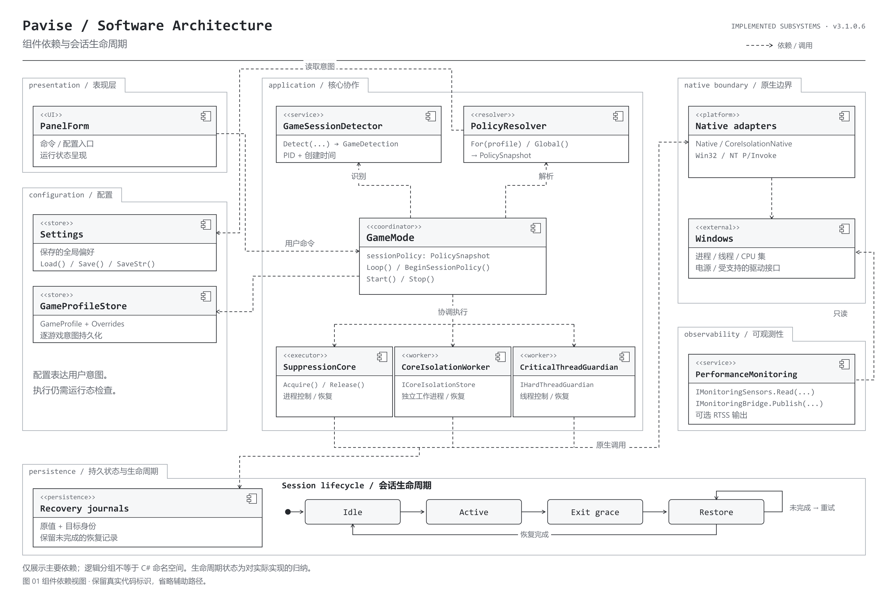
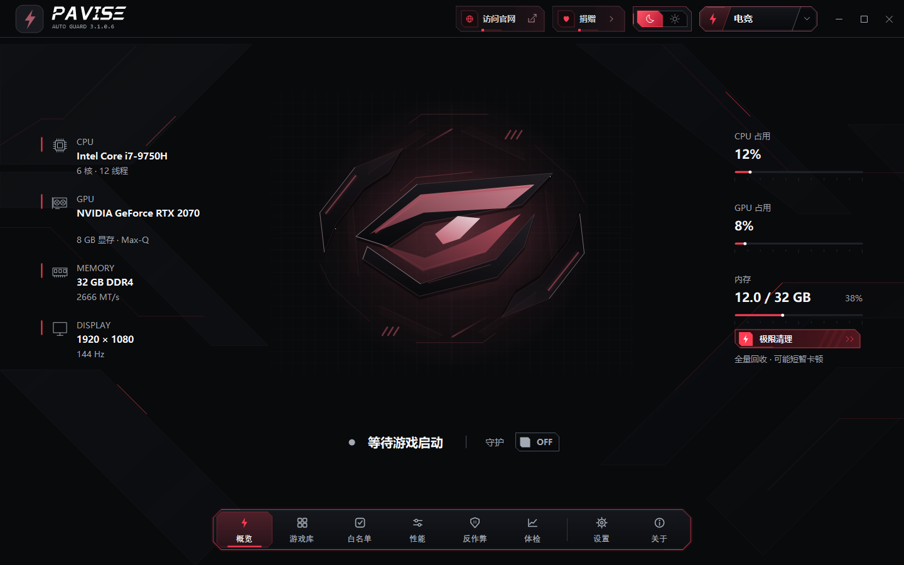
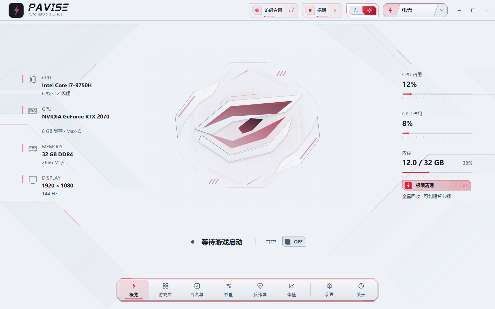
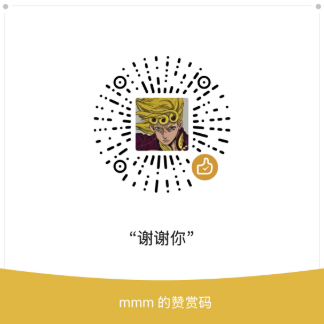

# PAVISE

### 以游戏会话为边界，组织系统资源。

围绕游戏身份、用户意图与恢复记录构建的 
Windows 资源控制系统。

[English](README.en.md) · **简体中文** · [日本語](README.ja.md)

**3.1.0.6 源码整理中，过几天会上传。** 仓库中的历史源码暂不代表本次发布的最新实现。

**[官网](https://pavise.club/) · [下载](https://pavise.club/changelog/#latest) · [使用教程](https://pavise.club/docs/)**

## 系统设计

*图 1 · 组件依赖与会话生命周期。[矢量原图](docs/pavise-architecture.zh-CN.svg)。*

Pavise 把游戏运行期间的资源控制组织为一段有边界的会话。先确认游戏及关联进程，再将已保存的选择解析成有效策略，通过 Windows 原生接口执行，并在会话结束后按记录恢复。

**范围先于强度。** 进程身份、前台状态与 CPU 拓扑共同限定目标。游戏执行路径与后台资源竞争分别处理，保护规则和运行时支持条件参与准入。

**意图与观测分开。** 配置决定请求什么，当前状态决定此刻能否执行。遥测用于观察和比较，性能配置由用户选择。

**恢复是控制的一部分。** 适用的改动保留原值与恢复记录，退出时复核并恢复，未完成的恢复保持待处理。持久设置与缓存操作遵循各自的生命周期。

## 实际界面

*3.1.0.6 界面。截图使用演示数据，不代表性能测试结果。*

亮色主题

## 运行

需要 Windows 10 2004（内部版本 19041）或更新版本、.NET Framework 4.7.2+；资源控制需要管理员权限。

下载并完整解压发布包，将 `Pavise.exe`、`Pavise.exe.config`、`LICENSE` 和 `NOTICE` 放在同一目录。添加游戏，检查已保存的策略，再开启守护。配置与恢复方式见[使用教程](https://pavise.club/docs/)。

效果取决于游戏、硬件和所选配置。请在相同负载下比较；开启更多控制项不保证性能更高。

## 项目

[问题反馈](https://github.com/dulaiduwang003/Pavise-Game/issues) · [贡献者](https://github.com/dulaiduwang003/Pavise-Game/graphs/contributors) · [作者 bdth](https://github.com/dulaiduwang003) · [支持开发](https://pavise.club/support/)

当前版本请使用验证过的发布包，源码整理后另行上传。反馈时请提供版本、环境和复现步骤，分享日志前检查个人信息。

Pavise 免费获取，打赏自愿。QQ 交流群：`166255062` / `1109874913`。

支持作者

 

**许可：** [GPL-3.0-only](LICENSE)，Copyright (C) 2026 bdth。项目声明见 [NOTICE](NOTICE)。
